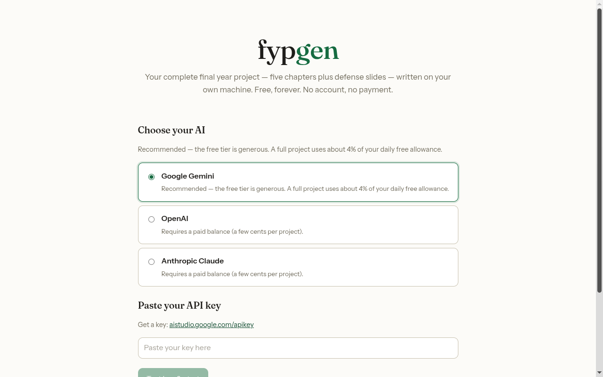
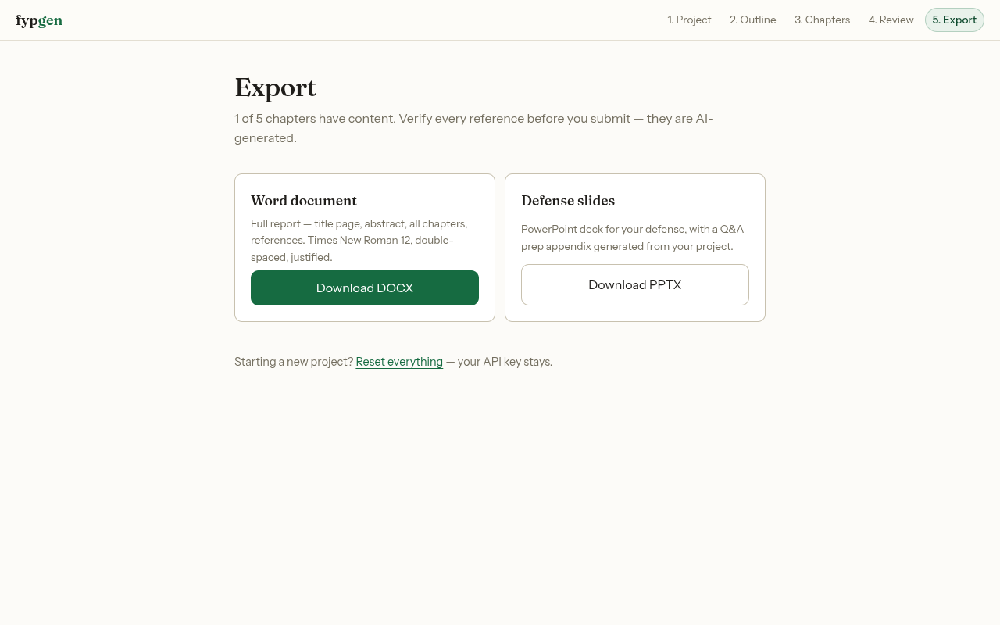
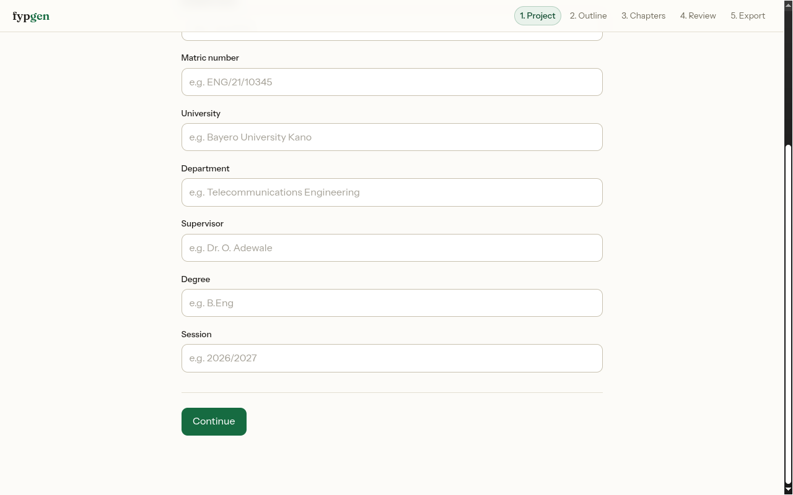
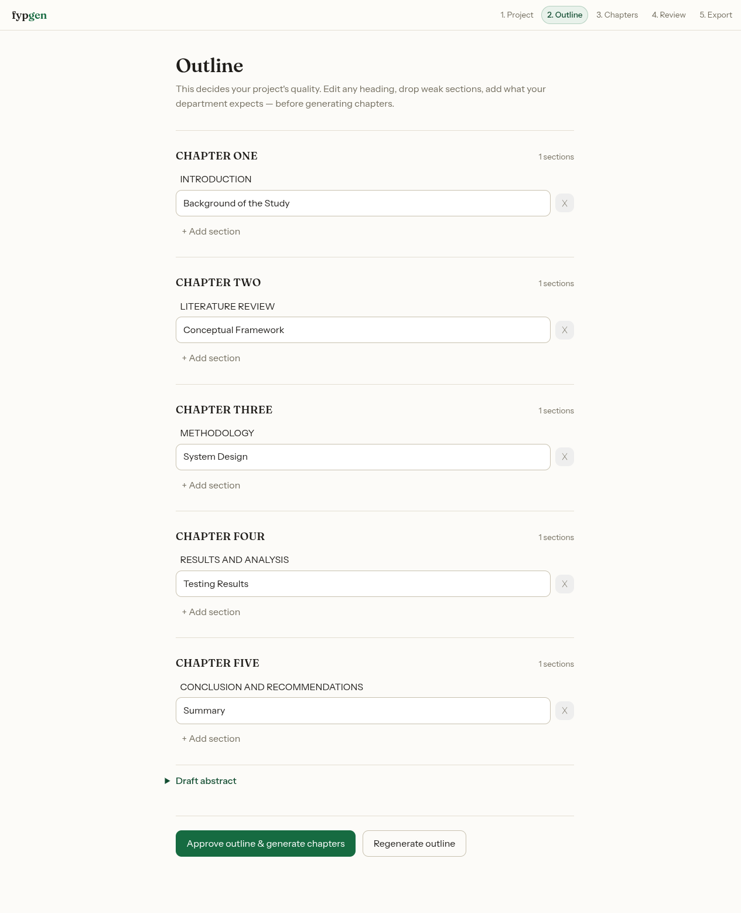
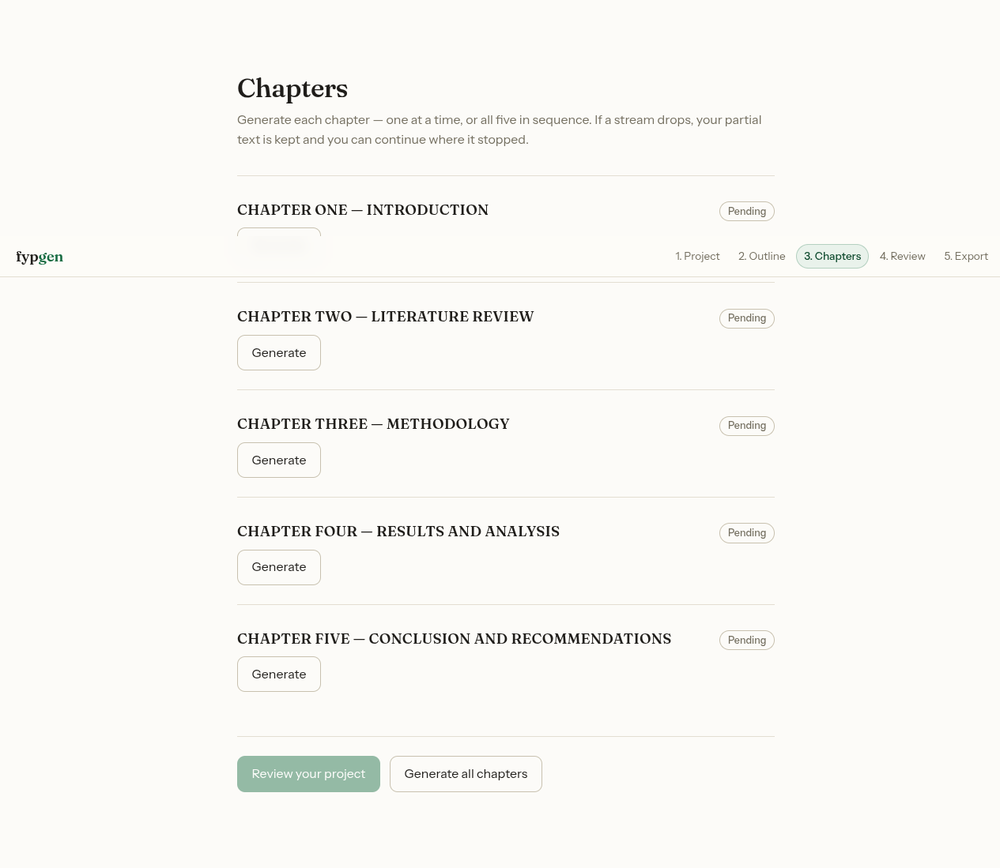

# fypgen

**Free forever, local Final Year Project report generator for Nigerian students.**

Generate a complete Nigerian final-year project — the standard five chapters plus a
defense slide deck — on your own machine. No account, no payment, no telemetry. You
bring your own AI API key, and everything runs locally: your topic, chapters, and key
never leave your computer except to talk to the AI provider you choose.

<p align="center">
  
  
</p>

## Highlights

- 📄 **Full five-chapter report** — proposes an editable outline, then generates each
  chapter with live streaming.
- 🎤 **Defense slides** — a themed PowerPoint deck with speaker notes and a Q&A prep
  appendix.
- 📝 **Formatted Word export** — Times New Roman 12, double-spaced, auto table of
  contents, APA 7 references.
- 📚 **Verified references** — citations are resolved and checked against Crossref, with
  review badges for anything that can't be confirmed.
- 🔑 **Bring your own key** — Google Gemini (has a free tier), OpenAI, or Anthropic.
- 🔒 **Local & private** — the server runs on `127.0.0.1`; your key is stored only in
  your browser's `localStorage` and sent only to your chosen provider.
- 💸 **Free forever** — no account, no paywall, no telemetry.

## Requirements

- [Node.js](https://nodejs.org) 18 or newer
- A free [Google Gemini API key](https://aistudio.google.com/apikey) — or an OpenAI /
  Anthropic key

## Quick start

```sh
npx fypgen
```

Your browser opens automatically at `http://127.0.0.1:3000`. Paste your API key once —
it is stored only in your browser and sent only to the server running on your own
machine. Press `Ctrl+C` in the terminal to stop.

If port 3000 is busy, fypgen picks a free port and prints the URL.

## Getting an API key

| Provider  | Where                                                  | Notes                  |
| --------- | ------------------------------------------------------ | ---------------------- |
| Gemini    | <https://aistudio.google.com/apikey>                   | Free tier — start here |
| OpenAI    | <https://platform.openai.com/api-keys>                 | Paid                   |
| Anthropic | <https://console.anthropic.com/settings/keys>          | Paid                   |

## How it works

1. **Onboarding** — paste your API key and pick a provider.
2. **Project setup** — topic, university, department, and supervisor details.
3. **Outline** — fypgen proposes a full five-chapter outline you can edit.
4. **Generate** — chapters are written one by one (or all in sequence) with live
   streaming and discipline-aware guardrails.
5. **Review** — read, edit, and regenerate any section.
6. **Export** — download a formatted Word document and a PowerPoint defense deck.

<p align="center">
  
  
  
</p>

## Privacy

fypgen has no backend of its own. The `npx fypgen` command runs a small server on your
own machine that serves the web app and proxies requests to the AI provider you picked.
Your API key lives in your browser's `localStorage`; your project content stays on your
machine. Nothing is uploaded to fypgen, and there is no analytics or telemetry.

## Behind a proxy or VPN?

Node (which fypgen uses) does not read your system proxy settings. If key testing fails
with a connection error, set the proxy explicitly before starting:

```sh
HTTPS_PROXY=http://your-proxy:port npx fypgen
```

## Important — verify before you submit

- **References are AI-generated.** Even with Crossref verification, citations can be
  wrong or fabricated. **Check every reference before submission.**
- fypgen is a **drafting aid**. Review and edit everything it produces, and follow your
  institution's rules on the use of AI in submitted work.

## Development

```sh
npm install

npm run dev:api   # terminal 1 — local API server on :3000 (no browser)
npm run dev       # terminal 2 — Vite dev server with HMR, proxies /api to :3000
```

### Scripts

| Command                 | What it does                                        |
| ----------------------- | --------------------------------------------------- |
| `npm run dev`           | Vite dev server (web) with hot reload               |
| `npm run dev:api`       | Build and run the API server on port 3000           |
| `npm run build`         | Build the web app and the server                    |
| `npm start`             | Run the built CLI (`node bin/fypgen.js`)            |
| `npm test`              | Server + shared unit tests (Vitest)                 |
| `cd web && npm test`    | Web unit tests (Vitest + Testing Library)           |
| `npm run e2e`           | End-to-end tests (Playwright, mock provider)        |

A typical full check:

```sh
npm test
cd web && npm test && cd ..
npm run build && npm run e2e
```

## Project structure

```
bin/          npx entry — boots the local server and opens the browser
server/       Hono API server
  providers/  AI providers: gemini · openai · anthropic · mock
shared/       constants shared by the server and web app
web/          Vite + React app
  src/screens/  onboarding → setup → outline → generate → review → export
  src/ai/       outline / references / slides parsing and guardrails
  src/export/   Word (docx), PowerPoint (pptx), Markdown, charts, TOC
docs/         design specs, plans, and UI screenshots
e2e/          Playwright happy-path test
```

## Tech stack

- **CLI / server:** Node.js, [Hono](https://hono.dev), undici, citation-js
- **Web:** React 18, Vite, Zustand, [docx](https://github.com/dolanmiu/docx),
  [pptxgenjs](https://gitbrent.github.io/PptxGenJS/), marked
- **Tests:** Vitest, Testing Library, Playwright

## License

This project does not yet declare a license. Until a `LICENSE` file is added, all rights
are reserved by the author. If you intend fypgen to be open source, add an OSI-approved
license (for example MIT).
